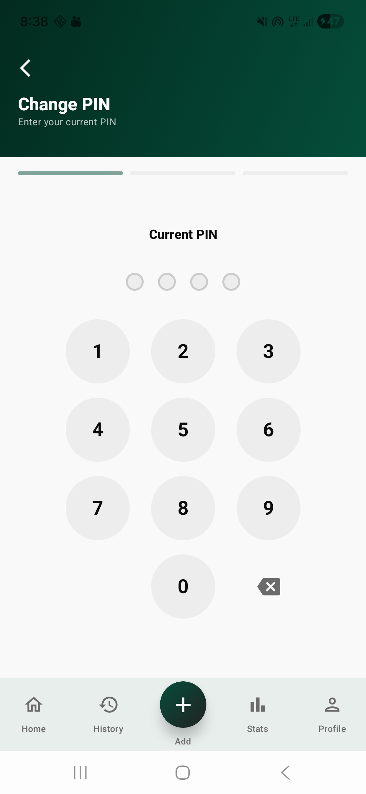

# MoneyTracker - Screen List & UI Overview

This document provides a comprehensive list of all screens implemented in the MoneyTracker application along with their UI descriptions and actual screenshots.

---

## 1. Authentication & Onboarding

### Splash Screen
Initial loading screen featuring a pulsing currency logo (₹) and a multi-color gradient background (Green/Teal).
**UI Components**: Pulsing ring animation, infinite transitions, version badge.

### Login Screen
The entry point for existing users. Features a deep green gradient header with decorative "blobs".
**UI Components**: Google Sign-In button, email/password fields with icons, error banners.

### Register Screen (Multi-step)
A multi-step registration process (Basic Info -> Personalization -> Security) with a linear progress indicator.

#### Step 1: Basic Info

#### Step 2: Personalization

#### Step 3: Security

### Forgot Password Screen
A dedicated screen to request password reset links.
**UI Components**: Email input field, success/error feedback cards.

*(Screenshot coming soon)*

---

## 2. Core Dashboard (Bottom Navigation)

### Home Screen
The main dashboard giving a quick overview of the user's financial status.
**UI Components**: Balance card, recent transactions list.

### History Screen
A comprehensive, searchable, and filterable list of all financial records.
**UI Components**: Search bar, category filters.

### Add Transaction
A detailed form for recording income, expenses, FD, and RD.

#### Expense Type

#### FD Type

#### RD Type

### Analytics Screen
Data visualization for spending patterns and budget tracking.
**UI Components**: Summary cards, Money Flow stacked bar.

### Profile Screen
The central hub for user account and app-wide settings.
**UI Components**: User profile summary, settings navigation menu.

---

## 3. Transactions

### Edit Transaction
Modification interface for existing financial entries.
*(Uses same layout as Add Transaction)*

---

## 4. Settings & Personalization

### Edit Profile

### Notifications

### Currency

### Biometric Lock

### Change PIN

---
*Last updated: April 2026*
